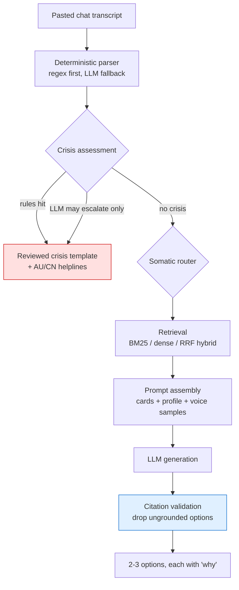

# HeartBridge

[](https://github.com/LeonaZ-zxq/heartbridge/actions/workflows/tests.yml)
[](https://www.python.org/)
[](LICENSE)

**A retrieval-grounded assistant that helps the partner of someone with depression decide what to say — and understand why it works.**

You paste the conversation you're stuck in. HeartBridge classifies the risk level, retrieves relevant grounded guidance, and returns 2–3 reply options — each one carrying the mechanism behind it, not just a script to copy.

> ⚠️ HeartBridge is a communication-skills assistant. It is not therapy, it does not diagnose, and it is not a crisis service. Every response carries a disclaimer and escalation resources.

---

## Results at a glance

| Metric | Result |
|---|---|
| Retrieval — clean test set, Recall@3 | BM25 **48.7%** · first number quotable without a caveat; dense and rerank pending (see [Results](#results)) |
| Crisis detection — 61 labelled cases | recall **100%** (19/19), false alarms **0%** (0/27) · enforced as a CI release gate |
| Test suite | **240 tests**, fully offline — no API key, no GPU, no network |

---

## Why this exists

Partners and family members are the people most often in the room when someone with depression is struggling, and they are almost never given anything usable. "What do I actually say right now" is a real, recurring, high-stakes question, and the advice available online is scattered, unsourced and generic. Clinical guidance exists — Beyond Blue and Healthdirect publish good material — but it is written to be read calmly in advance, not consulted at 2am mid-conversation.

HeartBridge is built for that moment: retrieval over structured, sourced guidance, returned as concrete options with the reasoning attached.

It is also deliberately built as an engineering artefact. Every design decision below was made against a measurement rather than a preference, and where a measurement contradicted the popular choice, the measurement won.

---

## What's interesting about it (engineering)

| Decision | Why |
|---|---|
| **Safety constraints live in the type system, not the prompt** | A somatic-symptom card without an authoritative source raises at load time. Prompt instructions are best-effort; type constraints are not. |
| **Crisis detection is rules-first, LLM-second, and asymmetric** | The LLM may only *escalate* risk. A non-deterministic component is never allowed to silence a safety signal that has already fired. |
| **Crisis responses are hardcoded templates, not generated** | On the highest-risk path, predictability and auditability beat personalisation. A template can be reviewed word-by-word by a human and asserted line-by-line in tests. |
| **The ReAct agent cannot skip the crisis check, by construction** | The check is not a tool the model may choose — it runs before the model gets its first turn. On a crisis input the model is never called at all, which is a line in a test rather than a line in a prompt. |
| **Every reply option must cite a retrieved card, and the citation is validated** | A citation to a card that was not retrieved is a hallucination, and is dropped before the user sees it. |
| **Three evaluation sets, with a different rule for each** | dev is for tuning and is contaminated by design. Held-out was spent on backend selection, three times over, and its 70.0% is diagnostic only. A third set was authored blind to the corpus and labelled blind to the retriever, and may be used for reporting once — nothing may be tuned on it. |
| **In the ingestion pipeline, provenance is stamped by code, not generated** | `source` and `id` are overwritten from download metadata after the model returns. A model cannot invent where a piece of advice came from, because it is never asked to. |
| **All LLM calls sit behind one interface with a deterministic mock** | The entire 240-test suite runs offline, free, and reproducibly — including in CI, with no API key and no GPU. |
| **Both evaluations run in CI, and crisis recall is a release gate** | `eval_safety.py` exits non-zero on any missed crisis case, so a regression fails the build rather than showing up on a dashboard. |

---

## Results

**Retrieval**, measured at 49 cards. Two sets; the held-out one is the number that counts. See below for what happened when the base grew to 101.

| Backend | Dev R@1 | Dev R@3 | **Held-out R@1** | **Held-out R@3** | Held-out MRR |
|---|---|---|---|---|---|
| BM25 | 90.6% | 100.0% | 33.3% | 36.7% | 0.350 |
| **Dense** (bge-small-zh) | 87.5% | 96.9% | **60.0%** | **76.7%** | **0.672** |
| Hybrid (RRF) | 90.6% | 100.0% | 40.0% | 70.0% | 0.522 |

Two findings that changed the code:

- **The dev set is contaminated and the 100% is meaningless.** Each card's document-expansion terms were written after inspecting dev-set failures — test-set leakage. The held-out set was authored independently, entirely from paraphrased queries, and BM25 drops from 100% to 36.7% on it.
- **Hybrid retrieval lost to dense alone on the held-out set** (70.0% vs 76.7%). RRF weights both retrievers equally; when one is substantially weaker, fusion drags the result down. "Hybrid is always better" did not survive contact with the measurement, so the default backend is `dense`.
- **Growing the knowledge base made the score worse — and the new cards were innocent.** Expanding from 49 to 101 cards dropped held-out R@3 from 76.7% to 60.0%. The obvious reading is that the new material was noise. Of the 12 failing queries, only one returned a new card. The real cause was that somatic cards were indexed as bare noun phrases ("short of breath") while queries arrive as full sentences ("he says he can't catch his breath") — same vocabulary, different *register*, so the two landed in different regions of the embedding space. Generating a sentence-form variant of every alias recovered R@3 to 70.0%, with no change to the data, the model or the backend. The new cards did not introduce the defect; they enlarged the candidate pool until an existing weakness stopped getting away with it.

> **Caveat that matters more than the numbers: the held-out set is no longer clean.** It was used to choose the backend, then to diagnose the register defect, then to verify the fix. 70.0% should be read as evidence that the register hypothesis was correct — not as a publishable retrieval score. A third, never-inspected evaluation set is the current blocker, and no headline retrieval number should be quoted until it exists.

Full methodology in [`docs/EVALUATION.md`](docs/EVALUATION.md).

**Generation quality** — a blind A/B, not a self-assessment

Reply options are generated twice per situation: once through the normal RAG
path, once with the knowledge base withheld. Both sets are shuffled together
with their source hidden, and rated by hand against one question — *would I
actually send this?* The result is a comparison against a control, not an
unanchored score. An LLM-as-judge runs the same rubric as a cheap regression
sentinel, and is explicitly **not** the acceptance criterion: self-preference
and position bias are known, and its correlation with human judgement in this
domain is unverified. See [`docs/EVALUATION.md`](docs/EVALUATION.md) §3.

**Crisis detection** (61 cases: 19 crisis / 15 elevated / 27 normal, including adversarial benign cases)

| Metric | Result |
|---|---|
| Crisis recall | **100%** (19/19) — zero tolerance |
| False-positive rate | **0%** (0/27) |
| Severity downgrades | 0 |

The first evaluation run caught 3 genuine misses. Rules were fixed and the cases locked in as tests.

---

## Architecture



The crisis branch short-circuits **before** retrieval and generation, so a crisis response never depends on model state.

Core logic lives in `core/` as a plain Python package with no framework dependency. CLI, and any future Discord bot or web UI, are thin callers. See [`docs/ARCHITECTURE.md`](docs/ARCHITECTURE.md).

---

## Quick start

```bash
git clone <this repo> && cd heartbridge
python3 -m venv .venv && source .venv/bin/activate
pip install -r requirements.txt

# Demo mode — no API key, deterministic mock LLM
python scripts/advise.py --demo --profile examples/sample_profile.json --text "小鱼 23:45
我觉得我就是个废物"

# Reproduce every number in this README
python scripts/eval_retrieval.py --set both      # retrieval
python scripts/eval_index_ablation.py            # index-text ablation
python scripts/eval_safety.py                    # crisis detection
python scripts/eval_generation.py generate       # generation A/B (needs an API key)
pytest -q                                        # 240 tests, incl. Streamlit UI
```

For real generation, copy `.env.example` to `.env` and set a provider (OpenRouter or Gemini).
For dense/hybrid retrieval, additionally `pip install sentence-transformers`.

---

## Privacy

A partner's mental-health information is the most sensitive category of personal data there is. The design reflects that:

- **Local-first.** Profile and transcripts live in SQLite on the user's own machine. `data/` is gitignored in full.
- **Data minimisation.** Every profile field is optional; empty fields are not even injected into prompts.
- **Local embeddings.** `bge-small-zh` runs on CPU, so retrieval never sends the user's text to a third party. The privacy requirement drove the model choice, not the other way round.
- **Erasure.** `delete_profile()` exists and is covered by a test.
- **The demo deployment uses fabricated data only.**

---

## Repository layout

```
streamlit_app/         5-page web UI; the deployed demo runs with fabricated data only
core/
  config.py            all model names, thresholds, paths — no hardcoding
  knowledge/           card schema, BM25 / dense / RRF / cross-encoder rerank, evaluator
  safety/              two-stage crisis detector, crisis templates
  engine/              prompt assembly, generation, citation validation, pipeline
  agent/               ReAct loop, tool calling, enforced safety invariants
  profile/             partner profile model + local SQLite store
  ingestion/           yt-dlp download, local Whisper ASR, LLM distillation
  utils/               LLM abstraction (Groq / Gemini / OpenRouter / Mock), transcript parser
knowledge_base/cards/  tiered cards, every one carries a source
tests/                 offline suite; fixtures hold every evaluation set
scripts/               reproducible evaluation + CLI
docs/                  architecture, evaluation methodology
```

## Knowledge base sourcing

101 cards, and they are deliberately **not** all the same kind of source. That is what `evidence_tier` is for.

| Tier | Cards | Origin |
|---|---|---|
| `clinical_guideline` | 27 | [Beyond Blue](https://www.beyondblue.org.au/), [Healthdirect Australia](https://www.healthdirect.gov.au/) |
| `lived_experience` | 44 | Chinese mental-health creators, distilled and hand-reviewed |
| untiered (predates the field) | 30 | Original core set, clinical material |

The tier is load-bearing, not a label. Somatic-symptom cards **structurally cannot exist** without an authoritative source — the validator rejects them at load time — so lived-experience material can never become the basis of a symptom claim. And the tier is stamped by code during ingestion rather than written by the model, so a distilled card cannot promote itself to clinical.

**Distillation is not transcription.** Where a creator's advice did not hold up, it did not become a card. Medication guidance from short-form video was dropped in full. Self-harm "substitutes" that still route through physical discomfort — holding ice, chilli, cold water — were left out, because they preserve the exact mechanism they claim to replace. One boundary-setting card carries a constraint the original did not have: that boundary-setting is the wrong tool while self-harm threats are live. Without that line the card is dangerous. The knowledge base is answerable for every piece of advice it carries, whether or not the original author was.

## Status & roadmap

Working today: knowledge base, retrieval + evaluation, crisis detection, reply generation, generation-quality evaluation, ingestion pipeline, CLI, CI, and a 5-page Streamlit UI.
Next: human blind-rating results on the generation A/B, then a Discord bot.

See [`docs/DEPLOYMENT.md`](docs/DEPLOYMENT.md) for how to run it, and for why the public demo deliberately ships without an API key.

## Licence

MIT
